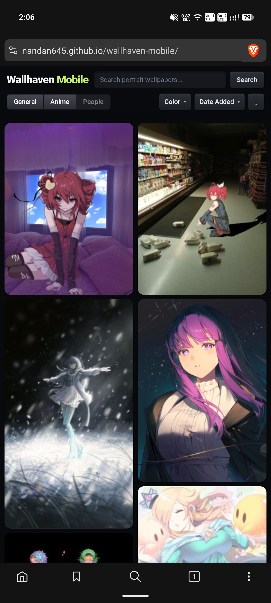
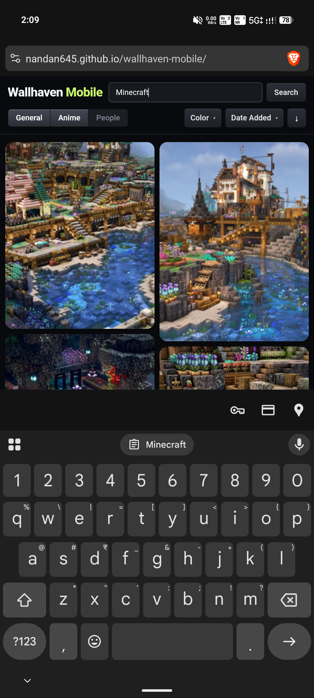
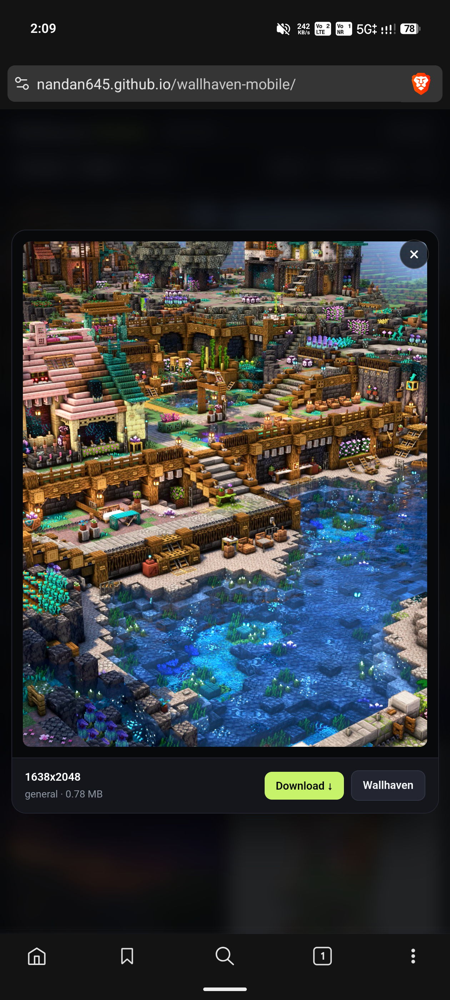
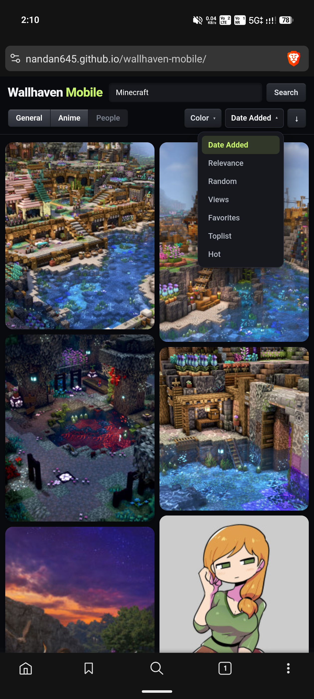

# Wallhaven Mobile 📱

A fast, clean, mobile-first web app for browsing and downloading high-resolution portrait wallpapers directly from [wallhaven.cc](https://wallhaven.cc).

🔗 **Live Demo:** [https://nandan645.github.io/wallhaven-mobile/](https://nandan645.github.io/wallhaven-mobile/)

---

## ✨ Features

- **Strict 2-Column Mobile Layout** — Designed specifically for handheld phone screens.
- **Natural Aspect Ratios** — Uses uncropped original thumbnails so images retain their true proportions with zero awkward cropping or stretched heights.
- **Dynamic Height Balancing** — Automatically places wallpapers in the shortest column to keep bottoms level.
- **Search & Filters** — Real-time keyword search, categories (*General*, *Anime*, *People*), 28-color palette swatches, sort order (*Date Added*, *Toplist*, *Views*, etc.), and ascending/descending toggle.
- **High-Res Lightbox Modal** — Clean preview with resolution and file size, loading animation while full image downloads, and a 1-click **Download ↓** button.
- **Infinite Scrolling** — Smooth, lag-free infinite scroll powered by `IntersectionObserver`.

---

## 📸 Screenshots

| 2-Column Gallery | Search in Action |
|:---:|:---:|
|  |  |

| Fullscreen Lightbox & Download | Filter & Sort Options |
|:---:|:---:|
|  |  |

---

## ⚙️ How It Works & Solving CORS

### 1. The CORS Challenge
Wallhaven's official public API (`https://wallhaven.cc/api/v1/search`) does not include `Access-Control-Allow-Origin` headers. Because GitHub Pages is purely static hosting (HTML/CSS/JS running entirely inside the client's browser), direct browser `fetch()` requests to Wallhaven get blocked by the browser's Same-Origin Policy (CORS).

### 2. The Cloudflare Worker Solution
To solve this cleanly without needing a bulky server, a lightweight, free **Cloudflare Worker** acts as a reverse proxy:
- The browser queries the Worker edge endpoint.
- The Cloudflare Worker fetches data from Wallhaven's API on the edge.
- The Worker returns the JSON response with `Access-Control-Allow-Origin: *` headers attached.
- Latency remains under 50ms while running completely free on Cloudflare's global edge network.

### 3. Modular & Zero Dependency
- Pure HTML5, modern CSS3 (Flexbox, CSS Grid, Custom Properties), and vanilla ES6+ JavaScript.
- No bulky UI frameworks, build steps, or external dependencies.

---

## ⚠️ Disclaimers

- This is an unofficial, fan-made, non-commercial open-source project.
- This application does not host or store any images; all images, thumbnails, and metadata are streamed directly from Wallhaven and their respective CDN servers.
- All wallpapers and artwork belong to their original artists, photographers, and copyright holders.

---

## ❤️ Credits

- Massive thanks and credit to **[Wallhaven.cc](https://wallhaven.cc)** for providing the platform and free public API.
- Wallpaper artwork belongs to the respective creators and uploaders on the Wallhaven community.
